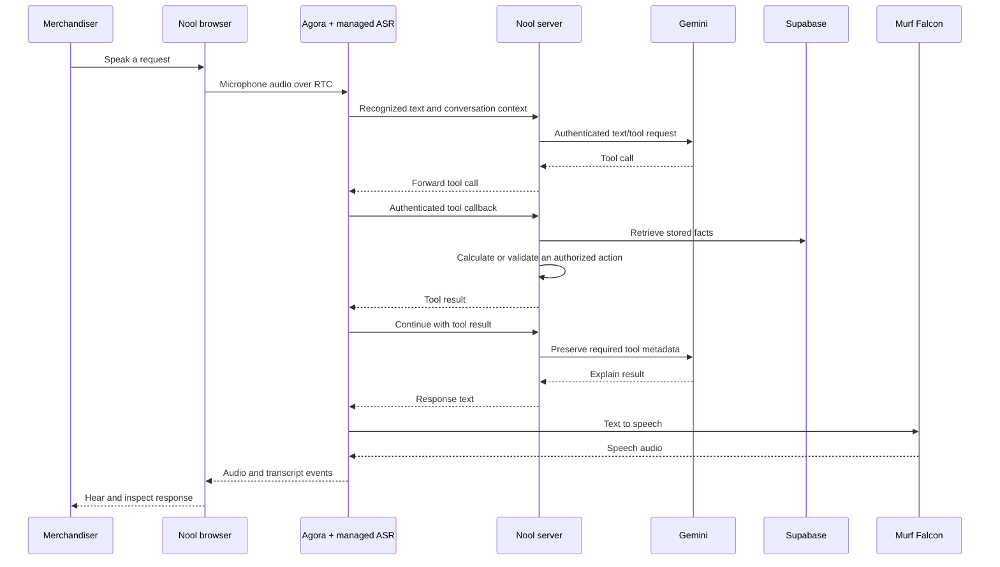

# Nool: workflow and presentation guide

This document explains the application as implemented in this repository. Use [README.md](README.md) for installation and environment setup. This guide is for understanding the product, preparing a demonstration, and answering questions about what actually works.

## 1. What is Nool?

**Nool is a voice-assisted workspace for deciding whether a garment order change is feasible and submitting that change for production approval.**

A buyer asks a merchandiser to increase an order from 500 to 600 pieces without changing the shipment date. The merchandiser needs to check fabric, unfinished production, available working dates, finishing time, and other buyers' commitments before promising anything.

Nool brings those facts into one workspace. The user can investigate by voice or ordinary controls, compare calculated plans, and submit one plan. A production lead makes the final approval decision.

The central distinction is:

> A buyer requests a date. Nool calculates an estimate. A production lead approves a commitment.

## 2. The responsibilities of each service

| Component | Its job in this application | What it does not do |
| --- | --- | --- |
| **Next.js application** | Provides the screens, authenticated server endpoints, deterministic calculations, proposal submission logic, and voice-session management. | It does not represent a connection to a factory ERP or physical machinery. |
| **Supabase** | Stores operational records in PostgreSQL, signs users in through Auth, enforces organization access, runs transactional database functions, and supplies Realtime change notifications. | It does not invent recommendations or synthesize speech. |
| **Agora** | Connects browser audio through RTC and orchestrates the Conversational AI Engine pipeline, including ASR, LLM requests, tool callbacks, and speech output. | It does not decide whether garment capacity is available. |
| **Managed Deepgram ASR** | Converts incoming English speech into text. It is configured through Agora's managed credentials. | Murf and Gemini are not the speech-recognition component in this implementation. |
| **Gemini** | Understands the text request, interprets corrections, chooses tools, and explains the returned facts in conversational language. | It is not the source of truth for stock, capacity, costs, or approval. |
| **Murf Falcon** | Converts the agent's response text into speech streamed through the live conversation. Voice and locale are configurable. | It does not calculate shipment plans, recognize the user's speech, or approve proposals. |

An easy way to explain the division of work:

> Agora manages the live conversation, Deepgram hears the user, Gemini interprets the request, Nool's backend calculates, Supabase stores and protects the records, and Murf speaks the response.

### Why use both Agora and Murf?

They solve different problems. Agora transports live audio and coordinates the agent. Murf supplies the spoken voice. A voice generator alone does not provide browser RTC sessions, agent lifecycle management, or tool execution.

### Why use Gemini if calculations are deterministic?

People do not always ask in form-field language. They say things like “Would another line help?” or correct an earlier quantity. Gemini handles that conversational interaction. The backend still calculates feasibility from records using explicit rules. This lets the same request produce consistent calculations through voice and clicks.

## 3. What is real, what is sample data, and what is limited?

**The demonstration uses fictional business data stored in a real database. It is not a production factory deployment.**

| Area | Current implementation |
| --- | --- |
| Company, buyers, orders, lines and fabric values | Seeded sample business data, not imported customer or factory records. |
| Order and resource screens | Read persisted Supabase records. Operational screens do not substitute browser-only mock records when configuration is missing. |
| Sign-in and roles | Real Supabase Auth accounts and organization memberships. The user cannot select an approval role in the interface. |
| Material and capacity calculations | Real deterministic TypeScript calculations using the stored inputs. They are estimates within a deliberately simplified planning model. |
| Stock and capacity edits | Real backend writes with reasons and audit history. Subsequent evaluations use the changed records. |
| Proposal submission | Real persisted, versioned proposals, with idempotency handling. A pending proposal does not itself reserve the additional resources. |
| Production approval | A real PostgreSQL transaction/RPC that validates permissions and current resources before applying the change. It is not a frontend status toggle. |
| Production tasks | Real database task records and controlled status updates. They do not prove that physical sewing or finishing happened. |
| Voice conversation | Real Agora, ASR, Gemini and Murf requests when configured. Live transcripts are provider events, not a prerecorded conversation. |
| Greeting and fallback messages | Configured application text. The greeting is spoken through the voice pipeline; it is not proof that a calculation or submission succeeded. |
| Buyer communication | An editable draft generated from the applied plan by database logic. It is not a Gemini-written email and is not sent automatically. |
| Realtime updates | Real Supabase subscriptions, with refresh/polling recovery. They depend on the deployed project's configuration and connectivity. |
| Setup screen | Configuration checks. A variable being present does not prove that the provider account has access, quota, or a working connection. |
| Automated tests | Calculation fixtures and PostgreSQL tests using PGlite, plus optional browser/live diagnostics. Tests are not production factory data or a substitute for live provider verification. |

Do not call the sample data “live factory data.” A more accurate presentation statement is:

> “We use a seeded garment-company scenario, but the application reads and changes those records through a real backend.”

## 4. The business workflow, step by step

### A. Find and understand the order

The merchandiser signs in, searches Orders, and opens the workspace for order 1042. The workspace shows the buyer, quantity, completed work, sizes, fabric reservations, production allocations, and shipment commitment.

The fresh sample scenario starts with 500 pieces, including 200 already completed. Previously approved changes can alter that baseline, so check the stored order before presenting.

### B. Ask for a change

The user can enter a new quantity using ordinary controls or start a voice conversation:

> “Increase order 1042 to 600 pieces. Can we keep the shipment date?”

Voice is an input method for the same workflow. The order controls remain useful when the microphone or a provider is unavailable.

### C. Evaluate feasibility

The backend loads current records and calculates:

- Material for remaining work, using consumption and wastage assumptions.
- Reusable reservations for this order and reservations belonging to other orders.
- Remaining compatible line capacity on recorded working dates.
- Production completion, followed by finishing lead time and shipment readiness.
- Supported cost estimates and any missing cost inputs.

Completed garments and consumed material are preserved. Other buyers' allocations are not silently taken away.

### D. Compare feasible alternatives

In the fresh sample scenario, standard capacity cannot ship all 600 pieces on the original date. With the default reference date, the alternatives include:

- **Split:** 500 pieces on November 27, 2026, and 100 on November 28.
- **Later full shipment:** all 600 pieces on November 28.

The dates are derived from the seeded working slots and reference date. They are not a universal answer hardcoded for every 600-piece request.

Ask:

> “Would another production line help?”

Line B has an existing allocation for Studio Common's order 1048. Nool can explain that constraint; it does not automatically displace that buyer.

### E. Select, explain and confirm

Selecting a plan shows the proposed change in the workspace. It must not submit the proposal immediately.

Before submission, review the size split, shipment breakdown, assumptions, and missing costs. For the sample 600-piece proportional size split, the total is S 120, M 180, L 180, XL 120. This is the order-wide size split, not a calculated size-by-shipment packing manifest.

“Explain the cost before submitting” is not consent. Confirmation must occur in a separate turn after plan selection. Ordinary UI confirmation is also available.

### F. Submit for production approval

Submission creates a pending proposal and returns its stored ID. It does not approve the order or consume additional stock/capacity.

The merchandiser can submit. A production lead is required to approve. These are separate permissions and separate actions.

### G. Review and approve

The production lead opens Approvals and compares the current order with the proposed plan. Approval rechecks current records inside a database transaction.

If the order or resources changed after evaluation, the proposal can become stale. The user must recalculate rather than applying an outdated plan.

Rejection stores a reason. Successful approval updates the order, reservations and allocations, creates production tasks, records audit events, and generates an editable buyer-message draft.

### H. Follow through

The team tracks production tasks and reviews the buyer message. Saving the message persists the edit; it does not send email, WhatsApp, or a shipment notification.

## 5. What happens during a voice request?

The integration uses Agora Conversational AI Engine v2 and a cascading ASR -> text LLM -> TTS pipeline. It does not use Gemini Live for audio.

Gemini connects through Nool's `/api/voice/llm` relay. This preserves Google's required thought-signature metadata between tool calls and tool results. The relay buffers a completion before emitting SSE, which adds latency but allows the metadata to be saved before callbacks execute.

The six agent tools are `findOrders`, `getOrderContext`, `evaluateOrderChange`, `selectChangePlan`, `getProposal`, and `createChangeProposal`. There is no voice approval tool. Production approval happens through the production lead's authenticated application action.

## 6. How correctness is protected

### Calculations

Fabric stock and reservations use kilograms; requirements round up to a gram. Money uses integer paise. Capacity uses garments per line per working day. The model considers remaining work and preserves completed quantities.

Finishing is separate from production completion. Delivery is only calculated if transit assumptions exist. Overtime requires configured capacity/cost and user consent.

The current schema has no configured split-freight rate. A split plan therefore reports **cost unavailable**, with the missing cost named. Nool must not invent a complete quote.

### Submission

The backend does not accept the model's `confirmed: true` as sufficient by itself. The relay checks conversation consent and grants short-lived permission bound to a tool call, user turn, plan, and evaluation fingerprint. The callback checks that permission before submitting.

Confirmation handling has needed fixes during live testing. The guard is intentionally conservative, and its existence is not evidence that every ASR phrasing has been validated.

### Approval and concurrency

Approval checks the signed-in production role, organization ownership, proposal status, record versions, material and capacity. Related writes happen together, and failed transactions roll back.

Resource mutations lock the organization row first. This favors straightforward correctness over high write throughput: competing approvals serialize, and a resource change can make the other proposal stale. Repeated approval requests return the recorded result.

Supabase RLS and membership checks protect organization access. Privileged keys stay on the server. Voice callbacks use expiring session-scoped credentials; the user's browser does not receive provider secret keys.

## 7. Presentation walkthrough

Use separate browser profiles for the merchandiser and production lead.

1. **Show the problem:** open order 1042 and point out its current quantity and shipment commitment.
2. **Ask by voice:** request 600 pieces by the existing date. Wait for the response before asking the follow-up.
3. **Show the constraint:** ask whether another line helps; inspect Line B and order 1048 in the interface.
4. **Compare options:** explain the split and later-full-shipment plans. Identify estimated dates and missing freight cost.
5. **Confirm submission:** select a plan and confirm. Verify a pending proposal ID in Approvals; do not treat a spoken claim alone as proof.
6. **Approve as the lead:** inspect impacts and approve. Show the changed order, reservations, allocations, tasks, and audit history.
7. **Demonstrate adaptation:** change a dated capacity slot with a reason, then evaluate again. In the original seed, raising Line B's November 25 capacity from 100 to 200 makes more same-date work available. Verify the result against the current records if earlier changes have altered the scenario.

Prepare the scenario before the presentation. The seed does not reset an existing sample company, and previous approvals or resource edits affect future answers. Dates shift when the seed reference date changes.

If voice fails, say:

> “The live voice provider is unavailable or the confirmation has not completed. I can continue through the same backend using the workspace controls.”

Use the controls and inspect the persisted result. Do not describe that fallback as a successful voice submission.

## 8. What has actually been verified?

During development, real provider calls completed a 600-piece evaluation and returned the 500 + 100 shipment split through ASR, Gemini tools and Murf speech. Repeated headless voice tests also stalled before a callback, and user testing exposed confirmation failures.

After the confirmation fixes, a local production-server check verified this path against real Gemini and Supabase:

> Exact confirmation prompt + “Yes” -> Gemini submission tool call -> authenticated callback -> pending 600-piece sample proposal -> retry returning the same proposal ID.

That check validates the backend submission path. It does **not** prove that live microphone recognition and multi-turn voice submission are consistently reliable on the deployed site. Recheck the latest deployed code before presenting.

Automated coverage includes calculations, reservations, completed work, split feasibility, stale proposals, idempotency, competing resource requests, RLS, rollback, and confirmation guards. SQL tests execute migration/RPC logic in PGlite; that is not a hosted PostgreSQL multi-connection contention test.

## 9. Current boundaries to explain honestly

- There is no ERP synchronization, machine telemetry, barcode scanning, or live physical stock feed. Users maintain the records.
- Capacity is a daily planning model, not a detailed factory scheduling or machine simulation engine.
- The alternate fabric is stored as sample master data; automatic fabric substitution and buyer approval for it are not implemented.
- Tasks record reported progress. They are not sensor-verified production or finishing certification.
- Buyer messages are editable drafts; no automatic outbound messaging is connected.
- English is supported initially. Tamil/code-mixed conversation has not been verified and should not be advertised as working.
- Master-data onboarding for real companies requires administrative provisioning. There is no complete organization/order-entry management console.
- Provider quota, network delays, ASR segmentation and conversational confirmation can affect voice reliability. Configuration readiness is not an end-to-end health check.
- Production requires a configured cleanup scheduler for expired voice agents. The repository does not ship a five-minute Vercel Hobby cron job.

## 10. A short presentation script

> “Nool helps garment merchandisers answer a difficult buyer request: can we increase an order without breaking shipment commitments?
>
> In our sample scenario, order 1042 increases from 500 to 600 pieces. Nool checks stored fabric reservations, remaining production capacity and finishing time. It finds that the original date cannot support all 600 under standard capacity, but a split shipment is feasible. Another line is already committed to another buyer, and Nool makes that constraint visible.
>
> Agora runs the live conversation, managed ASR transcribes speech, Gemini interprets the request and calls tools, and Murf speaks the explanation. The calculations come from deterministic backend rules, while Supabase stores the records and enforces the approval transaction.
>
> The merchandiser submits a proposal; a production lead approves the actual commitment. Our company and order values are seeded examples, but the persistence, calculations and approval workflow use a real backend. Voice has worked in live checks, though conversational confirmation still needs reliability validation.”

## 11. Questions you may be asked

**Is this just a chatbot?**  
No. The conversation is one interface to a stored, versioned operational workflow. The distinguishing behavior is checking real records, showing alternatives, and applying an authorized change transactionally.

**Does Gemini decide the shipment date?**  
It explains the calculated plans. Backend rules derive feasible dates from capacity, allocations and finishing assumptions. The production lead approves the commitment.

**What happens when two people want the same remaining capacity?**  
Approval rechecks and locks resources through the organization-level transaction strategy. A competing change can make the second proposal stale rather than allowing both to consume the same remaining capacity.

**Can the agent approve an order?**  
No. The voice agent can submit a confirmed proposal. Production approval requires the production lead's application action.

**Can I change a value and get a different answer?**  
Yes. Stock and dated capacity edits persist, and evaluation uses the updated records. This is the main adaptation demonstration.

**Is the demo using actual customer data?**  
No. It uses a clearly labelled sample company persisted in Supabase. It is not connected to a factory's systems.

**Why are some costs unavailable?**  
The application only calculates costs supported by configured inputs. Split freight is currently missing a configured rate. Reporting that gap is preferable to inventing a quote.

**Can it run without voice?**  
Yes. The ordinary order, evaluation, submission and approval controls use the real backend independently of the voice session.

## Landing-page demonstrations

The garment-table illustration autoplays while visible and responds to the pointer. It pauses on hover/focus, has a small pause control, and stays still for reduced-motion users. It is symbolic artwork, not a visualization of live factory movements. The sample conversation uses fixed, clearly labelled examples and starts no provider calls. The capacity preview uses real calculation rules over local seed fixtures, without saving changes. Actual orders, voice tools, proposals and approvals still use the authenticated backend.
